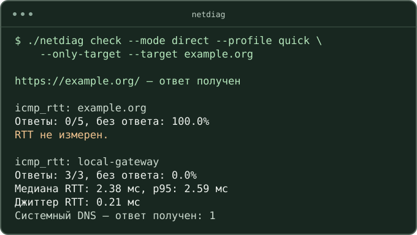

<h1 align="center"> netdiag</h1>

<p align="center"><strong>Проверьте, где обрывается соединение.</strong><br />
Проверка DNS, HTTPS и задержки для Windows, macOS и Linux.</p>

<p align="center">
  <a href="https://github.com/rnqg/netdiag/actions/workflows/ci.yml"></a>
</p>

<p align="center">
  <a href="#установка">Установка</a> · <a href="#запуск">Запуск</a> · <a href="docs/guide.ru.md">Руководство</a> · <a href="README.md">English</a>
</p>

<p align="center">
  
</p>

В этом замере сайт открылся по HTTPS, хотя на пинг не ответил.
netdiag показывает эти результаты отдельно и измеряет RTT до шлюза.
Для обычной проверки не нужны аккаунт и измерительный сервер.

## Установка

Сборка из исходников с Go 1.27.4 или новее. Поддерживаются amd64 и arm64.

```sh
git clone https://github.com/rnqg/netdiag.git
cd netdiag
go build -o netdiag ./cmd/netdiag
```

На Windows соберите через `go build -o netdiag.exe ./cmd/netdiag` и запускайте `.\netdiag.exe` в PowerShell.

## Запуск

**Проверить один сайт.** Увидеть, отвечает ли DNS и проходят ли TCP, TLS и HTTP.

```sh
./netdiag check --mode direct --profile quick \
  --only-target --target example.org
```

**Измерить качество связи.** Посмотреть перцентили RTT, джиттер и число проб без ответа.

```sh
./netdiag quality --mode direct --duration 60s
```

**Сравнить работу без VPN и с VPN.** Выполните первую команду без VPN, включите его и запустите вторую.

```sh
./netdiag check --mode direct --output direct.json
./netdiag compare --baseline direct.json --mode vpn
```

**Измерить скорость и буферблоат.** [Измерительный узел](docs/guide.ru.md#свой-измерительный-узел) нужен для замеров скорости и p95 RTT до, во время и после нагрузки. Перед запуском задайте токен узла в `NETDIAG_NODE_TOKEN`:

```sh
./netdiag speed --mode direct --node https://node.example.org:8443
```

## Документация

- [Команды, отчёты и исправления DNS](docs/guide.ru.md)
- [Настройка измерительного узла и Docker](docs/guide.ru.md#свой-измерительный-узел)
- [Протокол измерительного узла](PROTOCOL.md)

[Apache 2.0](LICENSE) · [Лицензии зависимостей](THIRD_PARTY_NOTICES.md)
